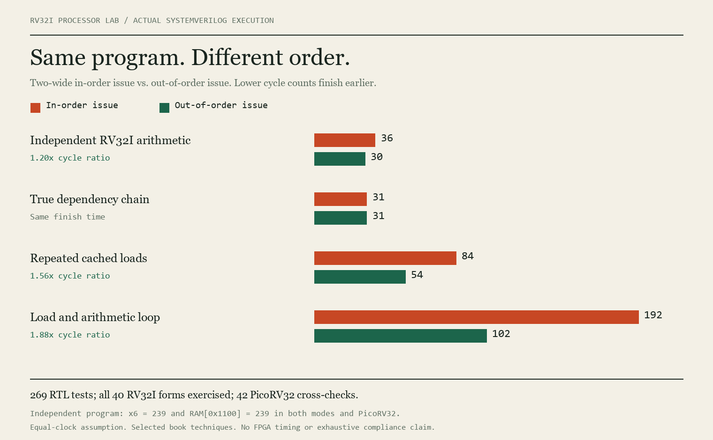

# Superscalar Processor Lab — RV32I

After reading John Paul Shen and Mikko H. Lipasti's *Modern Processor Design: Fundamentals of Superscalar Processors*, I implemented selected superscalar and out-of-order techniques in a synthesizable **RV32I processor**, then compared its results with in-order issue and the original **PicoRV32** core.

**Relationship to PicoRV32:** the OoO core is a separate implementation with a standard RV32I frontend. This repository integrates a pinned, unmodified PicoRV32 as a reference CPU; it does not claim that PicoRV32's internal pipeline was converted to OoO. It implements selected mechanisms from the book, not every technique.

## Results from actual RTL



The controlled comparison changes only `OOO`. Both modes use two-wide hardware, renaming, a ROB, the same cache and execution latencies. In-order **issue** can still have out-of-order long-latency completion; both retire in order.

| RV32I workload | In-order issue cycles | OoO issue cycles | In-order / OoO |
|---|---:|---:|---:|
| Independent RV32I arithmetic | 36 | 30 | 1.20x |
| True dependency chain | 31 | 31 | 1.00x |
| Retirement-bound work | 32 | 32 | 1.00x |
| Cache locality | 84 | 54 | 1.56x |
| Repeated loads, prediction disabled | 192 | 102 | 1.88x |
| Squashed pending load | 40 | 46 | 0.87x |

The independent-work program produces **x6 = 239** and **RAM word64 = 239**, at byte address `0x1100`, in both lab modes and PicoRV32. True dependencies and retirement bottlenecks limit the benefit of scheduling. A squashed pending read can make OoO slower because it occupies the single read slot.

These are cycle measurements under an equal-clock assumption, not measured FPGA frequency, wall-clock performance, area, or power.

### Actual PicoRV32 reference

The same standard instruction streams and initial RAM were run on the upstream PicoRV32 with dual-port registers, a barrel shifter, no compressed instructions, and the same data cache.

| Program | PicoRV32 cycles | Lab in-order cycles | Lab OoO cycles |
|---|---:|---:|---:|
| Independent arithmetic | 95 | 36 | 30 |
| Dependency chain | 90 | 31 | 31 |
| Cache locality | 248 | 84 | 54 |
| Repeated loads | 629 | 192 | 102 |

PicoRV32 is scalar and has a different frontend and memory protocol. This comparison includes those differences; it does **not** isolate the effect of adding OoO to PicoRV32. The two lab configurations above isolate scheduling more closely.

## What I implemented

| Stage | Hardware |
|---|---|
| Fetch | Two contiguous instructions, byte PCs, finite queue, backpressure, six direction predictors, tagged indirect-target BTB, speculative fetching |
| Decode | Standard RV32I R/I/S/B/U/J formats, legal function checks, signed immediates, all 32 registers, all 40 base instruction forms |
| Dispatch / rename | In-order allocation, 32-entry RAT and committed map, 64 physical registers, free bitmap, 16-entry ROB and instruction window; optional scoreboard |
| Issue | Tag readiness, oldest-ready scheduling, two issue slots, resource checks, ordered-issue comparison switch |
| Execute / writeback | RV32I ALU/shift/compare operations, six branch conditions, JAL/JALR links, address generation, tagged completion |
| Memory | Little-endian byte/halfword/word accesses, signed/unsigned loads, partial-store merge, covered-byte forwarding, conservative ordering, data cache, one outstanding read, FENCE ordering |
| Retire / recover | Two ordered commits, stores at retirement, precise stopping exceptions, physical-register reclamation, branch squash, rename reconstruction, rejection of stale load responses |
| Optional | Unknown-store bypass with byte-overlap replay, last-value load prediction with validation, complete Zmmul multiplication, exact multiply reuse |

RV32I has no multiply instruction. `ENABLE_MUL=0` is the default; `ENABLE_MUL=1` adds **MUL, MULH, MULHSU, MULHU** (Zmmul), without DIV/REM. The multiplier is unsplit arithmetic followed by four delay registers, not a balanced arithmetic pipeline.

## Verification

- **269 RTL runs passed**, including directed cases and twelve randomized seeds.
- **8,113 retired instructions checked** against the independent interpreter.
- Every run compares all **32 registers**, all **256 RAM words**, ordered retirement PCs, and exception **PC/cause/value**, with per-cycle structural invariants.
- The suite exercises all **40 RV32I instruction forms**, including ECALL/EBREAK stopping exceptions; see [instruction coverage](results/isa_coverage.json).
- **42 unmodified PicoRV32 cross-checks passed** for successfully terminating RV32I/Zmmul programs, comparing all registers and RAM. Fault cases use the independent interpreter, not an assertion of identical PicoRV32 fault interfaces.
- Current-source Yosys structural/no-latch checks: **in_order, out_of_order, all_options, out_of_order_zmmul**.

These are directed and seeded tests, not exhaustive/certified ISA compliance, formal proof, FPGA placement/routing, or silicon validation. [The manifest](results/manifest.json), [measurements](results/summary.csv), and [full run data](results/results.json) provide the evidence. [Download the complete evidence archive](evidence.zip) for all generated programs, per-run CSV traces, simulation/synthesis logs, and waveforms. The source and sample programs are also browsable directly in this repository; the runner regenerates every test program.

### Optional-feature costs

Memory speculation changes the nonaliasing test from **41 to 33 cycles**, but the aliasing test from **31 to 37** due to replay. Load-value prediction takes **110 versus 102** cycles. Exact reuse takes **43 versus 43** on the Zmmul loop despite cache hits. More mechanisms do not guarantee better performance.

## Run the comparison

Install Python 3.10+ and Icarus Verilog (`iverilog`, `vvp`), then:

```sh
python run_lab.py --waves
python run_picorv32.py
python build_report.py
```

Open `report.html` locally for the pipeline timelines and all comparisons. The runner uses the Python standard library. A quick subset is `python run_lab.py --quick`; it replaces the stored results with that subset. Run the full command again to restore the complete regression.

Install Yosys for structural synthesis, then:

```sh
python synthesize.py
python summarize_results.py
python build_report.py
```

GitHub Actions runs the lab regression, PicoRV32 cross-checks, and structural synthesis. Locally recorded results are included; a GitHub CI run is not claimed until it actually runs.

## Execution environment and limits

Instruction ROM is execute-only at `0x0000..0x03ff`; little-endian data RAM is at `0x1000..0x13ff`. Four-byte instruction alignment is required; misaligned halfword/word accesses trap. ECALL/EBREAK stop at precise retirement. There is no privileged CSR/trap-handler implementation, instruction cache, MMU, OS, interrupts, SMT, coherence, or formal memory-model certification. Zicsr, Zifencei, counters, compressed instructions, division, and atomics are not implemented.

See [architecture and interfaces](docs/ARCHITECTURE.md) and [book coverage](COVERAGE.md). The primary ISA reference is [RV32I version2.1](https://docs.riscv.org/reference/isa/v20260120/unpriv/rv32.html).

## Repository guide

| Path | Purpose |
|---|---|
| `rtl/core.sv` | RV32I OoO/in-order-issue backend |
| `rtl/data_cache.sv` | Shared data-cache model and backing RAM |
| `rtl/processor_system.sv` | Educational top level and host/debug ports |
| `rtl/picorv32_reference_system.sv` | Separate upstream PicoRV32 with the same memories |
| `third_party/picorv32/` | Pinned upstream source, ISC license and provenance |
| `tb/` | Simulation-only testbenches |
| `isa.py`, `reference.py`, `workloads.py` | Standard encoding, independent interpreter, tests |
| `run_lab.py`, `run_picorv32.py` | Reproducible RTL comparisons |
| `synthesize.py` | Structural synthesis checks |
| `report.html`, `results/`, `programs/` | Interactive report, evidence, standard RISC-V programs |

## Reference and third-party notice

John Paul Shen and Mikko H. Lipasti, *Modern Processor Design: Fundamentals of Superscalar Processors*. No book text is redistributed. PicoRV32 is from [YosysHQ/picorv32](https://github.com/YosysHQ/picorv32), commit `ef203c2b0a3fb793280f5114941416c425c5b461`, with its ISC license preserved. That license covers upstream PicoRV32; no project-wide license is implied.
